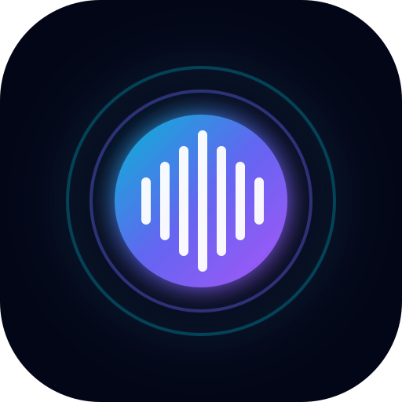

# Gemini Live Voice & Multimodal Assistant 🎙️⚡

A real-time, low-latency conversational AI application powered by Google's **Gemini Multimodal Live API** (`ai.live.connect`). Features bidirectional streaming audio, natural barge-in interruption, live camera/screen vision at 1 FPS, voice persona customization, and real-time function calling.



---

## ✨ Features

- ⚡ **Ultra-Low Latency Duplex Voice**: Direct audio streaming over WebSockets via `ai.live.connect`.
- 🛑 **Native Barge-In Interruption**: Halts AI audio playback instantly when you begin speaking.
- 🔊 **24kHz Gapless Audio Playback**: Precise timeline jitter scheduling with Web Audio API for pop-free, human-like speech.
- 🎙️ **16kHz 16-bit PCM Audio Capture**: In-browser client recording and format conversion.
- 👁️ **Multimodal Vision Streaming**: Real-time webcam or screen-share frame streaming (1 FPS JPEG) directly to Gemini Live.
- 🎭 **5 Expressive Prebuilt Voices**: Switch between `Zephyr`, `Puck`, `Charon`, `Kore`, and `Fenrir` with voice previews.
- 🧠 **Dual Model Architecture**: Choose between `gemini-3.8-live` (conversational speed) and `gemini-3.8-live-extended-thinking` (complex reasoning).
- 🛠️ **Real-Time Tool Calling**: Built-in function calling for real-time timezone queries (`get_current_time`) and accurate math computation (`calculate_expression`).
- 📱 **Progressive Web App (PWA)**: Installable directly to iOS Safari, Android Chrome, and Desktop as a standalone app.

---

## 🚀 Quick Start (Local Setup)

### 1. Clone the repository
```bash
git clone https://github.com/<your-username>/gemini-live-app.git
cd gemini-live-app
```

### 2. Install dependencies
```bash
npm install
```

### 3. Configure your API Key
Create a `.env` file in the root directory:
```bash
cp .env.example .env
```
Add your free Gemini API key from [Google AI Studio](https://aistudio.google.com):
```env
GEMINI_API_KEY="AIzaSy..."
PORT=3000
```

### 4. Run the development server
```bash
npm run dev
```
Open **[http://localhost:3000](http://localhost:3000)** in your browser!

---

## 🐳 Docker Deployment

You can build and deploy the application anywhere using the included `Dockerfile`:

```bash
# 1. Build the Docker container
docker build -t gemini-live-app .

# 2. Run the container
docker run -d \
  -p 3000:3000 \
  -e GEMINI_API_KEY="your-gemini-api-key" \
  --name gemini-live \
  gemini-live-app
```

Visit `http://localhost:3000` to start conversing!

---

## 🏗️ Architecture Overview

```text
[ Browser Client ]
  ├─ Microphone (16kHz PCM little-endian)
  ├─ Camera / Screen (1 FPS JPEG)
  ├─ 24kHz Web Audio Player (gapless queue)
  └─ WebSocket Client (/live-ws)
             ▲
             │ Full-Duplex WebSocket
             ▼
[ Server (server.ts) ]
  ├─ Express + ws (WebSocketServer)
  ├─ @google/genai SDK (ai.live.connect)
  └─ Realtime Tool Handler (Time & Math)
             ▲
             │ Low-Latency Streaming TPU Session
             ▼
[ Google Gemini Live TPU Cluster ]
  └─ gemini-3.8-live / gemini-3.8-live-extended-thinking
```

---

## 🔒 Security

- The `GEMINI_API_KEY` is kept **server-side only** inside `server.ts` / `server/live-service.ts`.
- It is **never** sent to the client browser bundle.
- In production, set your API key in environment variables or cloud secret managers.

---

## 📜 License

Apache-2.0
